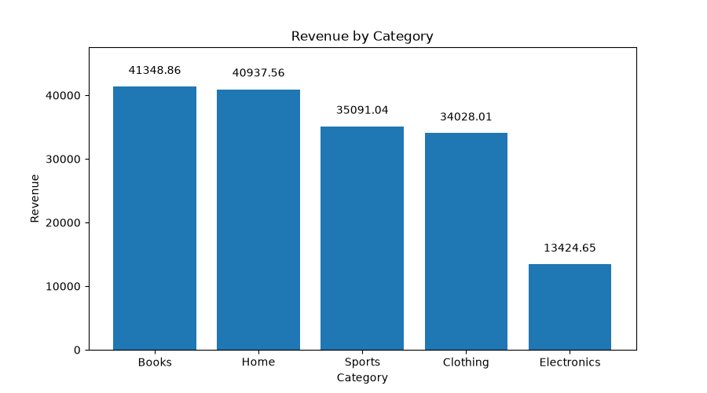
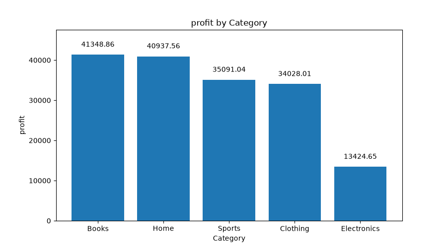
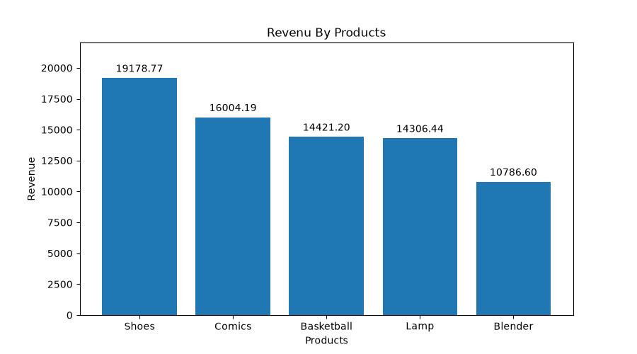
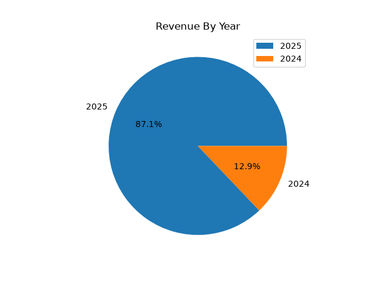

# 🛒 E-commerce Sales Analysis

## 📌 Project Overview
This project focuses on analyzing an E-commerce sales dataset to explore business performance, identify revenue trends, and gain insights into product and category profitability.

The project uses Python for data cleaning, data analysis, and visualization.

## 🛠️ Tools & Technologies
- Python
- Pandas
- NumPy
- Matplotlib
- Microsoft Excel

## 📂 Project Files
| File | Description |
|---|---|
| `ecommerce_orders.xlsx` | Original dataset |
| `ecommerce_orders_cleaned.xlsx` | Cleaned dataset |
| `ecommerce_orders.py` | Python analysis script |
| `Revenue_By_Category.png` | Revenue analysis by category |
| `Profit_By_Category.png` | Profit analysis by category |
| `Revenue_By_Products.png` | Revenue analysis by products |
| `Revenue_By_Year.png` | Revenue trends by year |

## 🔍 Project Workflow
1. Data Loading and Exploration
2. Data Cleaning and Preparation
3. Exploratory Data Analysis (EDA)
4. Revenue and Profit Analysis
5. Data Visualization

## 📊 Visualizations

### Revenue by Category

### Profit by Category

### Revenue by Products

### Revenue by Year

## 🎯 Project Objectives
- Understand overall E-commerce sales performance.
- Analyze revenue across different product categories.
- Identify products generating the highest revenue.
- Explore yearly revenue trends.
- Evaluate profitability across categories.

## 👨‍💻 Author
**Mahmoud Nader**

[GitHub](https://github.com/MahmoudNader1) | [LinkedIn](https://linkedin.com/in/mahmoud-nader-810291405)
